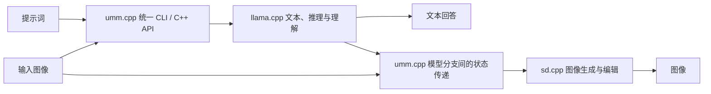

# umm.cpp

使用 C++ 实现的统一多模态推理框架。

umm.cpp 将文本与图像生成整合到同一套命令行和 C++ API 中。[llama.cpp](https://github.com/ggml-org/llama.cpp) 负责文本分支，[stable-diffusion.cpp](https://github.com/leejet/stable-diffusion.cpp)（sd.cpp）负责图像分支，umm.cpp 协调两个分支的执行与状态传递。

## 模块设计

两个引擎分别执行各自分支的计算，umm.cpp 负责组织跨分支流程。

| 组件 | 职责 |
| --- | --- |
| **llama.cpp** | 执行理解分支，进行自回归文本生成 |
| **sd.cpp** | 执行图像生成分支，负责像素流采样和图像解码 |
| **umm.cpp** | 按模型组织提示词和图文执行顺序，传递分支间的状态，提供统一接口 |

SenseNova U1 和 BAGEL 都采用 MoT 结构，将多模态推理分为语言和图像两个分支。U1 将理解前缀的注意力 K/V 状态从 llama.cpp 传给 sd.cpp。BAGEL 由 llama.cpp 处理文本、推理和视觉 token 的顺序，再通过模型专用的图像和潜变量接口交给 sd.cpp 执行扩散。umm.cpp 封装这些流程，让各模型使用统一的 CLI 和 C++ API。



每个引擎管理自己执行的计算图和算子。接入新模型时，可以复用公共层，只需补充该模型的提示词格式、模型包组件及分支交接规则。两个引擎在同一个进程内共享 GGML，并分别执行各自的前向计算。

### 源码目录

| 目录 | 职责 |
| --- | --- |
| `src/inference/` | 模型包、推理会话和共用工作流接口 |
| `src/inference/models/` | U1 和 BAGEL 的工作流及模型规则 |
| `src/adapters/` | 对接 llama.cpp、sd.cpp 和 MTMD 视觉编码器，包括 K/V 状态传递 |
| `src/scheduling/` | 执行策略选择、计算图放置和权重副本管理 |
| `src/scheduling/policies/` | 本地 310P、远端 910B 和随机放置策略，每种策略一个实现文件 |
| `src/runtime/` | 请求处理、HTTP 服务、运行监控和图像读写 |
| `src/profiling/` | 采集计算图和分层计时并导出结果 |
| `src/apps/` | CLI、会话程序和服务端入口 |
| `include/` | 会话 API 及其公开类型 |
| `tools/` | 分析工具的命令行入口、采集校验脚本和模型实验工具 |
| `tests/` | 分析工具回归测试、后端冒烟测试和 RPC 隧道测试 |

## 支持的模型

| 模型系列 | 当前支持情况 |
| --- | --- |
| [SenseNova U1 系列](https://github.com/OpenSenseNova/SenseNova-U1) | 首个接入的模型系列，当前实现和验证覆盖稠密版 SenseNova U1.5 |
| [BAGEL-7B-MoT](https://huggingface.co/ByteDance-Seed/BAGEL-7B-MoT) | F16 文本生成、生图和图像理解已在昇腾 310P 上跑通。编辑模式可以执行，但生成的编辑结果仍会退化为噪声，质量尚未通过验证。使用 Q8_0 理解权重和 F16 生成权重可单卡生图。 |

## 支持的模式

| 模式 | 输出 |
| --- | --- |
| `text` | 自回归生成文本 |
| `image` | 根据提示词生成图像 |
| `think-image` | 先生成推理文本，再生成图像 |
| `understand`、`think-understand` | 回答有关输入图像的问题 |
| `edit`、`think-edit` | 编辑输入图像，可选择先推理 |

## 平台支持

本仓库已在 Linux 上验证 NVIDIA CUDA 和昇腾 CANN。SenseNova U1.5 8 步 LoRA V2 已在单张昇腾 310P3、CANN 8.5.0 上验证，生图配置为 1024 × 1024、Euler 8 步、CFG 1、shift 3。基础模型的 50 步结果保留为历史对照。

模型计算图在 NPU 上执行。昇腾 310P 上的 BAGEL 单卡配置使用 Q8_0 理解权重和 F16 生成权重。CPU 负责分词、调度、文件读写和 PNG 编码等工作。已验证的昇腾配置及启动脚本见 [昇腾运行说明](scripts/ascend/README.md)。

## 构建与模型准备

需要 Git、CMake 3.21+ 和 C++17 编译器。在仓库根目录初始化依赖并构建。

```bash
git submodule update --init third_party/llama.cpp third_party/stable-diffusion.cpp
cmake -S . -B build -DCMAKE_BUILD_TYPE=Release
cmake --build build -j 8
```

CUDA 构建加上 `-DGGML_CUDA=ON -DSD_CUDA=ON`。昇腾构建见 [CANN 运行环境](docker/README.runtime.md) 和 [昇腾运行说明](scripts/ascend/README.md)。通过 RPC 连接远端还需启用 `-DGGML_RPC=ON`。

已有模型包时，直接将其目录传给下文示例。转换模型时，先安装 Python 依赖。以 SenseNova U1.5 8 步 V2 为例：

```bash
python -m pip install -r third_party/llama.cpp/requirements/requirements-convert_hf_to_gguf.txt
python scripts/convert-model.py /path/to/SenseNova-U1.5-8B-MoT \
  --output /path/to/u1.5-v2 --outtype q8_0 --generation-outtype f16 \
  --lora /path/to/SenseNova-U1.5-8B-MoT-LoRA-8step-V2.safetensors
```

使用正式发布的基础检查点。转换脚本也支持 BAGEL，可运行 `python scripts/convert-model.py --help` 查看参数。

## 快速开始

### 命令行调用

```bash
# 文本生成
build/bin/umm-cli --model /path/to/u1.5-v2 --mode text \
  --prompt '用一句话介绍月球。' --max-tokens 64

# 图像理解
build/bin/umm-cli --model /path/to/u1.5-v2 --mode understand \
  --input photo.png --prompt '这张图里有什么？'

# 文生图，使用 U1.5 V2 的 8 步配置
build/bin/umm-cli --model /path/to/u1.5-v2 --mode image \
  --prompt '白色背景上的红色立方体' --output cube.png \
  --width 1024 --height 1024 --steps 8 --cfg 1 --shift 3 --seed 42
```

| 参数 | 用途 |
| --- | --- |
| `--model`、`--prompt` | 模型包目录和提示词 |
| `--mode` | 默认 `text`。可选 `image`、`understand`、`edit`、`interleave`，以及对应的 `think-image`、`think-understand`、`think-edit`、`think-interleave` |
| `--input`、`--output` | 理解和编辑使用输入图像。生图和编辑使用输出文件，图文交错生成使用输出文件名前缀 |
| `--max-tokens`、`--max-images` | 文本 token 上限、图文交错生成的图片上限 |
| `--width`、`--height`、`--steps`、`--cfg`、`--shift`、`--seed` | 生成尺寸、步数、引导强度、采样偏移和种子 |
| `--execution-policy` | `local_310p` 固定使用本地 310P，`remote_910b` 固定使用远端 910B，`random` 在两端切分理解图，视觉编码和扩散在本地执行 |
| `--local-device`、`--rpc-endpoint` | 本地设备名（默认 `CANN0`）和远端 `HOST:PORT`。远端和随机策略需要 RPC 地址 |
| `--policy-seed`、`--policy-cuts` | 随机策略的放置种子和每张理解图的切分点数，默认分别为 `0` 和 `1` |
| `--n-ctx`、`--n-batch`、`--n-ubatch` | 上下文、批次和微批次的 token 容量 |

完整参数见 `build/bin/umm-cli --help`。

### HTTP 服务调用

先启动服务。示例使用本机 310P 和测试密钥。

```bash
export UMM_API_KEY=local-test-key
build/bin/umm-server --model /path/to/u1.5-v2 \
  --execution-policy local_310p --local-device CANN0 \
  --host 127.0.0.1 --port 8080 --served-model-name u15 \
  --api-key-env UMM_API_KEY --steps 8 --cfg 1 --shift 3
```

在另一个终端发起请求。

```bash
# 文本生成
curl -fsS http://127.0.0.1:8080/v1/chat/completions \
  -H 'Authorization: Bearer local-test-key' \
  -H 'Content-Type: application/json' \
  -d '{"model":"u15","messages":[{"role":"user","content":"用一句话介绍月球。"}],"max_tokens":64,"temperature":0}'

# 文生图，响应的 data[0].b64_json 是 Base64 编码的 PNG
curl -fsS http://127.0.0.1:8080/v1/images/generations \
  -H 'Authorization: Bearer local-test-key' \
  -H 'Content-Type: application/json' \
  -d '{"model":"u15","prompt":"白色背景上的红色立方体","size":"1024x1024","n":1,"response_format":"b64_json","umm_options":{"seed":42}}'
```

| 参数 | 用途 |
| --- | --- |
| `--host`、`--port`、`--served-model-name` | 监听地址、端口和请求中的模型别名。默认别名为 `u15` |
| `--api-key-env` | 保存密钥的环境变量名。启用后，请求带上 `Authorization: Bearer <密钥>` |
| `messages` | 对话接口接收一条 `user` 消息。可使用纯文本，或由文本与 PNG/JPEG Base64 数据 URL 组成的图文序列 |
| `max_tokens` 或 `max_completion_tokens` | 对话输出上限，二选一，默认 256。支持 `temperature: 0` 和 `stream: false` |
| `prompt`、`size`、`n` | 生图提示词、尺寸和张数。HTTP 尺寸默认 `1024x1024`，宽高为 32 的倍数且每边最多 2048，张数固定为 1 |
| `umm_options` | 生图请求可指定 `seed`、`steps`、`cfg` 和 `shift` |

每个服务进程同一时刻处理一条推理请求。可通过 `/health`、`/ready` 和 `/metrics` 查询运行状态。

### C++ API 调用

将程序链接到 CMake 目标 `umm`，包含 `session.h`。

```cpp
#include "session.h"
#include <iostream>

int main() {
    umm::session model("/path/to/u1.5-v2");
    std::cout << model.text("用一句话介绍月球。", 64) << '\n';

    umm::image_options options;
    options.width = 1024;
    options.height = 1024;
    options.steps = 8;
    options.guidance = 1.0f;
    options.flow_shift = 3.0f;
    options.seed = 42;
    const auto image = model.image("白色背景上的红色立方体", options);
    std::cout << image.width << " × " << image.height << '\n';
}
```

| 接口或参数 | 用途 |
| --- | --- |
| `umm::session(model)` | 加载模型包。构造函数也可指定理解、生成和视觉后端以及上下文、批次和微批次容量 |
| `text(prompt, max_tokens)` | 返回生成文本，`max_tokens` 默认 256 |
| `understand(image, prompt, max_tokens, think)` | 从 `image_input` 读取宽、高和 RGB 像素，返回图像理解结果 |
| `image(prompt, options)`、`edit(image, prompt, options)` | 生成或编辑图像。用 `image_options` 指定尺寸、步数、引导强度、种子等，结果的 `rgb` 字段保存像素 |
| `interleave(prompt, options, max_text_tokens, max_images)` | 返回文本和图像列表，适用于 SenseNova U1.5 |

完整签名及默认值见 [session.h](include/session.h)。

## 计算图分析工具

可以用离线工具 [Graph Atlas 查看器](https://github.com/umm4c/utils/blob/master/profiler-viewer/README.md) 浏览已有采集结果，包括可折叠的层级、算子依赖和设备放置。

[计算图分析工具](tools/profiler-cli/README.md) 在指定设备列表上重放模型和代表性负载，导出真实计算图、设备放置和同步主机计时。首版采集器支持在本地 310P 和已有的 CANN RPC worker 上运行 SenseNova U1。理解图另有层、块和可选算子计时。整图调度方案的合法性检查、设备内核计时和调度决策验证仍待完成。
